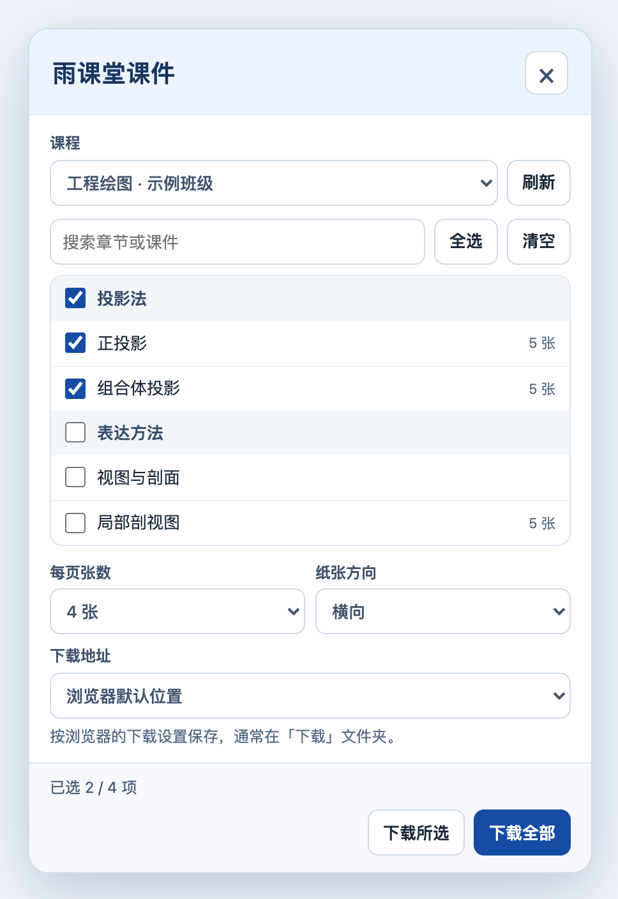
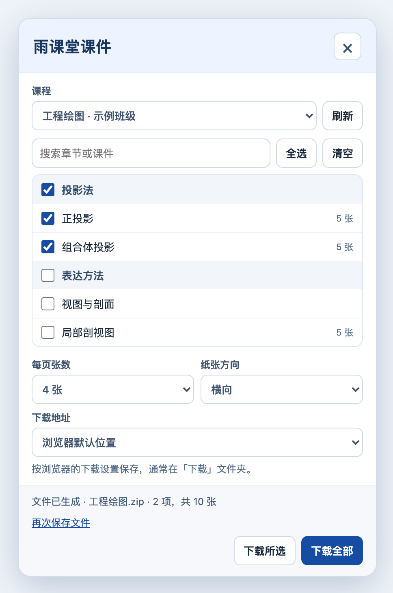

# 雨课堂课件批量下载

在新版雨课堂的课程页面，勾选课件就能导出 PDF。每个课件对应一份以标题命名的 PDF。选中多个课件时，按课程列表顺序编号并打包成 ZIP。

## 下载与安装

### Safari（macOS）

1. 下载 `ykt-downloader.user.js`。[Safari 用户脚本](https://github.com/SuisLec/ykt-downloader/releases/latest/download/ykt-downloader.user.js)
2. 安装 Userscripts，在 **Safari → 设置 → 扩展**中启用，并允许它访问雨课堂网站。[Userscripts 安装说明](https://github.com/quoid/userscripts#installation)
3. 打开 Userscripts 的工具栏弹窗，点击文件夹图标，将 `.user.js` 文件放进脚本目录。回到新版雨课堂课程页面，刷新后点击右下角的**下载课件**。

### Chrome 或 Edge（Windows、macOS）

1. 下载并解压安装包。[Chrome／Edge 扩展 ZIP](https://github.com/SuisLec/ykt-downloader/releases/latest/download/ykt-downloader-chrome-edge.zip)
2. 在地址栏打开 `chrome://extensions` 或 `edge://extensions`，启用**开发者模式**。
3. 点击**加载已解压的扩展程序**（Edge 为**加载解压缩的扩展**），选择包含 `manifest.json` 的 `ykt-downloader` 文件夹。
4. 登录新版雨课堂，打开或刷新课程页面，点击右下角的**下载课件**。

## 导出课件

1. 在面板中切换**课程**。可搜索章节或课件，勾选单项，或通过章节标题勾选整组。
2. 选择 A4 **横向**或**竖向**，每页排 **1、2 或 4 张**幻灯片。默认横向、每页 1 张。
3. 在**下载地址**选择**浏览器默认位置**或**每次选择位置**。
4. 点击**下载所选**导出勾选项，或点击**下载全部**导出当前课程列表中的所有课件，包括搜索结果之外的条目。

选择**浏览器默认位置**时，浏览器会在导出完成后自动发起下载。选了**每次选择位置**时，Chrome／Edge 可点击**选择保存位置**，也可右键选择**将链接另存为…**。Safari 中右键点击**保存文件**，选择**下载链接文件为…**。

导出优先使用雨课堂提供的原版 PDF，也支持按站点提供的分辨率将幻灯片图片排成 PDF。部分导出失败时，可在面板中查看失败条目并保存已生成的文件。

另附旧版更新步骤和固定保存目录的设置方法。[安装说明](outputs/安装说明.md)

## 演示

下面用示例课程演示选择课件和导出。




## 登录与隐私

扩展使用当前雨课堂标签页的登录状态，读取当前账号有权限访问的课件。PDF 排版和 ZIP 打包在浏览器内完成，文件直接保存到本地。下载地址偏好保存在浏览器本地。

## 从源码构建

在项目根目录用 Node.js 22 或更新版本运行以下命令。Safari 脚本和 Chrome／Edge 扩展包生成在 `outputs/` 中。

```sh
npm ci && npm run build
```

浏览器测试需要 Poppler 的 `pdftoppm`。构建后运行 `npx playwright-core install chromium` 和 `npm test`。需要测试 WebKit 时，运行 `npx playwright-core install webkit` 和 `npm test -- webkit`。

## 许可证

项目采用 [MIT 许可证](LICENSE)。安装包同时收录了 pdf-lib 和 JSZip 的许可证。

[pdf-lib 许可证](https://github.com/Hopding/pdf-lib/blob/v1.17.1/LICENSE.md) · [JSZip 许可证](https://github.com/Stuk/jszip/blob/v3.10.1/LICENSE.markdown)
